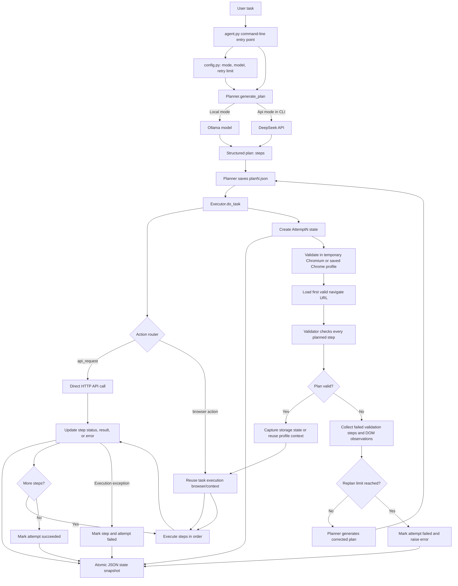

# Browser Automation Agent

An LLM-driven browser automation prototype. It accepts a natural-language task, asks a language model to produce a structured action plan, checks that plan against a browser page, and executes it with Playwright when validation succeeds. Invalid plans are sent back through a bounded validation-and-replanning loop.

The current implementation uses an API-first execution path inside the CLI. A plan can run a read-only HTTP API request directly with `httpx`; browser steps continue to use Playwright. Temporary browser contexts are used by default, with an optional isolated persistent Chrome profile for authenticated sites.


## Demos

- [Working demo](demos/working_demo.mp4) — Basic agent workflow
- [Browser setup](demos/setup_browser.mp4) — Persistent Chrome setup
- [Persistent Chrome demo](demos/run_agent_using_chrome_presistent_state.mp4) — Running with saved browser state


## Architecture and Flow



### Run lifecycle

1. `agent.py` validates the task argument and selects the configured model mode.
2. `Planner` creates a JSON-compatible plan and saves it in `saved_plan/`.
3. `Executor` creates an `Attempt1` state record and starts validation.
4. The validator checks each step against the page loaded at the plan's first valid `navigate` URL. It does not execute earlier actions to simulate later page states.
5. If validation fails, the executor records the validation results, gathers observations for failed target roles, and asks the planner for a corrected plan. This repeats up to `MAX_REPLAN_ATTEMPTS` times.
6. If validation succeeds, the executor transfers the validation context's storage state to the task's headed execution context on its first attempt, then keeps that browser, context, and page alive across replans.
7. The state snapshot is rewritten after lifecycle transitions and each execution-step transition. Exceptions are recorded before they are raised to the caller.

## Project Structure

```text
.
|-- agent.py                    # CLI and top-level planning/execution orchestration
|-- config.py                   # Model mode, names, paths, and replan limit
|-- Planner/
|   `-- planner.py              # Prompt construction, model calls, and plan saving
|-- Executor/
|   `-- action.py               # Validation/replanning loop and Playwright execution
|-- Validator/
|   `-- validate.py             # URL, action, target, and wait validation
|-- integrations/
|   `-- gmail.py                # Read-only Gmail OAuth/API integration
|-- tools/
|   |-- api_client.py           # Read-only direct HTTP API execution
|   |-- dom_observation.py      # DOM observations for failed target roles
|   |-- download.py             # Direct file-response downloader
|   |-- extractor.py            # Structured page-data and product-listing extraction
|   `-- load_json.py            # JSON file/string loading helpers
|-- state/
|   |-- agent_state.py          # Atomic JSON state writer
|   `-- agent_state.json        # Latest run snapshot (created at runtime, ignored by Git)
|-- saved_plan/                 # Generated plans and replans
|-- traces/                     # Browser screenshots and other run artifacts
|-- testing/                    # Manual Playwright exploration script
|-- free_memory/                # Standalone process/VRAM cleanup helpers
|-- requirements.txt            # Core Python dependencies
`-- .env.example                # Optional model and Gmail configuration
```

## Components

### API-first execution inside the CLI

The planner may create an `api_request` step when the task clearly identifies a read-only HTTP API endpoint:

```json
{
    "action": "api_request",
    "method": "GET",
    "url": "https://api.example.com/items",
    "params": {"query": "example"}
}
```

The validator checks the URL, method, query parameters, and headers before execution. The executor sends the request directly and stores its status code, content type, response data, and final URL in the normal attempt state. API-only plans do not launch Chromium. If a plan contains browser steps, those steps continue through the existing Playwright validation and execution flow.

Only `GET` generic API requests are enabled in this first slice so an LLM plan cannot create an unexpected write operation. Gmail search and sending use separate OAuth-backed actions and do not put access tokens in the generated plan. If a generic API request fails, the existing bounded replan path receives the failure and can choose a supported browser fallback.

### Gmail API setup

The CLI supports Gmail searching and sending through OAuth. It does not use a Gmail API key. Follow Google's [Gmail Python quickstart](https://developers.google.com/workspace/gmail/api/quickstart/python) while completing these steps:

1. Open [Google Cloud Console](https://console.cloud.google.com/) and create or select a project.
2. Enable **Gmail API** for that project.
3. Configure the OAuth consent screen:
   - Choose **External** for a personal Gmail account.
   - Add the Gmail account you will authorize as a **Test user** while the app is in Testing status.
   - Add the `gmail.readonly` and `gmail.send` scopes requested by this project.
4. Create an OAuth client with application type **Desktop app**. Do not use a **Web application** client for this CLI flow.
5. Download the JSON file and place it in the project root. You can rename it to `credentials.json`, or keep its downloaded filename and use that path in `.env`.
6. Install the dependencies:

```bash
python -m pip install -r requirements.txt
```

Configure the credential and token paths in `.env`:

```env
GMAIL_CREDENTIALS_FILE=credentials.json
GMAIL_TOKEN_FILE=gmail_token.json
```

If you keep Google's original downloaded filename, use that instead:

```env
GMAIL_CREDENTIALS_FILE=client_secret_<your-client-id>.apps.googleusercontent.com.json
GMAIL_TOKEN_FILE=gmail_token.json
```

Authorize the Gmail account once:

```bash
python agent.py --setup-gmail
```

The first run opens Google's consent flow and saves a local refreshable token to `gmail_token.json`. If you previously authorized only `gmail.readonly`, move or delete the old `gmail_token.json` before running setup again so Google requests the new send permission. If Google reports `access_denied` because the app is still being tested, add the authorizing account under the OAuth consent screen's **Test users**. If Google reports `redirect_uri_mismatch`, check that the credential JSON is a Desktop client whose top-level key is `installed`, not `web`.

After authorization, use a natural-language CLI task such as:

```bash
python agent.py "Use Gmail API to find unread emails from alice@example.com"
```

The planner can generate a search step like `{"action":"gmail_search","query":"is:unread from:alice@example.com","max_results":10}`. For an explicit send request, it can generate `{"action":"gmail_send","to":"person@example.com","subject":"Meeting update","body":"The meeting is confirmed."}`. Sending uses the authenticated Gmail account; the planner must not invent a sender address. Sending is not automatically retried because a timeout could occur after Gmail accepted the message. Deleting, modifying, attachments, drafts, and Gmail push notifications are not implemented yet.

Keep the OAuth client JSON, `gmail_token.json`, and `.env` private. They are ignored by Git in this project. Do not put Gmail access or refresh tokens in the task prompt or generated plan.

### `agent.py`: application entry point

`run(task)` rejects an empty task, constructs a planner, generates the initial plan, then creates a Playwright session and passes the plan and original task to the executor. Run the project through this file for the complete workflow.

The CLI accepts the task as positional text, so quote it when it contains shell-special characters. Use `-m/--mode` to choose `Local` (default) or `Api`; the `Api` branch selects DeepSeek and the `Local` branch uses the configured Ollama model.

### `Planner/planner.py`: plan generation

`Planner.generate_plan()` assembles the initial-task or replan prompt, calls the configured model, and parses/saves the model's structured JSON plan. Plans use a top-level `steps` array. Supported action names are `navigate`, `download`, `api_request`, `gmail_search`, `gmail_send`, `click`, `fill`, `press`, `select`, `wait`, and `extract`.

Initial plans are saved as `saved_plan/planN.json`; replans are saved with a `replanN.json` name in `saved_plan/`. Local mode uses a compact task-planning prompt, prints numbered plan-generation attempts, and retries incomplete plans with corrective feedback. Its completeness checks cover requested fields, required downloads, valid step references, named in-article links, and post-link article extraction. The planner supports an Ollama streaming path and HTTP API request paths. In the current CLI configuration, API mode chooses DeepSeek; other provider code is not exposed as a CLI option.

For `extract`, the prompt asks the model for an output `category` and the exact requested `fields`, without CSS selectors or DOM details. Article/resource workflows can extract fields such as `article_title`, `first_paragraph`, `official_website_url`, `documentation_url`, `resource_name`, and `resource_url`. Later `navigate` and `download` steps can reference fields from earlier extracts. Product-listing extracts also receive a `query` naming the specific product/model and are asked for `product_name`, `price`, `currency`, `retailer`, and `product_url`, preferring Flipkart for current Indian prices. The replan prompt additionally forbids attempting to solve human-verification challenges.

### `Executor/action.py`: orchestration and browser actions

`Executor.do_task()` creates numbered attempt records, validates the plan, requests replans when validation fails, and executes a plan only after it passes validation. By default, `validate_plan()` uses a temporary Chromium context. With `PERSISTENT_CHROME` enabled, validation and execution share the saved Chrome profile so both phases see its cookies and site sessions. The persistent context is reused across replans and closed when the task finishes or raises; its profile data remains on disk.

Execution dispatches each plan step to the corresponding API or Playwright operation. Read-only `api_request` steps use `tools/api_client.py` and do not require Chromium; browser steps keep the existing validation and execution flow. Retries remain bounded by `MAX_REPLAN_ATTEMPTS`. `navigate.url`, `download.url`, and `api_request.url` references are resolved from successful earlier extraction results at runtime; references to results from a previous attempt are materialized before replan validation. For Enter on a semantic `searchbox`, the executor submits its owning form and waits for a URL transition, avoiding stale-input races on sites such as Wikipedia. If search already navigated directly to the requested article, a matching redundant article-link click is treated as complete. Direct file downloads use `tools/download.py` and are saved under `downloads/`; the saved path is stored and printed. `extract` steps store structured results and trigger replanning when a page is blocked or requested fields are missing. Resource extraction only returns direct file links (recognized file extensions or a `download` attribute), not ordinary landing pages such as `/downloads/`. Screenshot capture is best-effort: failures are reported but do not fail the browser action. For India-market product lookups (`MARKET == "IN"`), `_route_product_search()` rewrites the navigation step to a Flipkart search or a DuckDuckGo/Bing/Brave search source.

### `Validator/validate.py`: pre-execution guardrail

`Validater` checks the plan structure and supported action type. Navigation and download actions require a valid HTTP/HTTPS URL or a reference to a field requested by an earlier `extract` step. `extract` actions require a non-empty `category` string and a non-empty list of non-empty `fields`. Target actions require a semantic target with a non-empty role and name. Exact accessible-name role matches are preferred; when candidates are duplicated, visible/action-capable elements are filtered so hidden sticky controls do not make a target ambiguous. Targets on the initially loaded page are preflight-checked; after page-changing actions, target availability is checked against the live page during execution.

Per-step validation records include the step number, action, role, rule description, and boolean validity. Structural errors are reported at plan level; target-check exceptions are collected in the validation result. Validation does not replay or simulate page transitions.

### `tools/dom_observation.py`: failed-target context

When validation fails, `find_relevant_element()` opens a separate headless browser at the current URL, inspects elements matching the failed role, and returns properties such as tag, name, placeholder, visibility, enabled state, and editability. This data is supplied to the planner for replanning; it does not execute a plan action.

### `tools/extractor.py`: structured page-data extraction

`extract_categorized(page, category, fields, query)` runs in-page JavaScript to collect structured data. It supports article titles and first paragraphs, official website links from labeled infobox rows, documentation links, and direct downloadable resources. For product categories it scans links whose text carries a currency/price pattern (₹, `Rs`, `$`, `€`, `£`) and returns `product_name`, `price`, `currency`, `retailer`, and `product_url` items (unwrapping DuckDuckGo redirect URLs). General fields can also come from JSON-LD, `<meta>` tags, and semantic elements (`dt`/`dd`, `th`/`td`, `<label>`, `<time>`). It detects human-verification prompts and reports them in a `blocked` field without attempting to solve them.

### `state/agent_state.py`: durable run snapshot

`save_agent_state()` serializes the in-memory state as formatted JSON. It writes a temporary file in the destination directory and uses `os.replace()` to replace the snapshot atomically. The default output is `state/agent_state.json`.

The executor keeps one top-level `AttemptN` entry per validation/replan attempt. An attempt contains the task, plan, validation report, execution-step records, status, and any error or replan details. The file represents the latest run; starting another run replaces the previous snapshot. It is not currently a resume/recovery mechanism.

Example shape (values abbreviated):

```json
{
    "task": "Search Wikipedia for Python tutorials",
    "Attempt1": {
        "attempt": 1,
        "replan_attempt": 0,
        "status": "replanned",
        "plan": {"steps": []},
        "validation": {"valid": false, "steps": []},
        "execution": {"current_step": null, "steps": []},
        "replan": {"status": "succeeded", "next_attempt": 2, "plan": {"steps": []}}
    },
    "Attempt2": {
        "attempt": 2,
        "replan_attempt": 1,
        "status": "succeeded",
        "validation": {"valid": true, "steps": []},
        "execution": {"current_step": null, "steps": []},
        "error": null
    }
}
```

Attempt keys are one-based (`Attempt1`, `Attempt2`); `replan_attempt` is zero-based. Validation failures live under `validation`; runtime action failures live on the corresponding item in `execution.steps` and on the attempt's error fields.

### Supporting modules

- `config.py` defines `MODE`, `MARKET`, model names, `MAX_REPLAN_ATTEMPTS`, `MAX_PLANNER_RETRIES`, `API_TIMEOUT_SECONDS`, plan paths, and the replan instruction. The default mode is `Local`.
- `config.py` also configures `PERSISTENT_CHROME`, `CHROME_CHANNEL`, and `CHROME_PROFILE_DIR` for saved Chrome sessions.
- `tools/load_json.py` provides helpers to load JSON from a file or string.
- `tools/download.py` fetches a direct file URL through the current Playwright page's request context, derives a safe filename, and returns the saved path.
- `tools/extractor.py` extracts structured page data and product listings, and flags pages that request human verification without attempting to solve it.
- `testing/testing.py` is a manual Playwright locator exploration script, not an automated regression test suite.
- `free_memory/free_Mmemory.py` provides a process RSS / glibc memory-trim helper. `free_memory/free_vram.py` contains a PyTorch CUDA cache helper. Neither is called by the main agent flow.
- `saved_plan/` contains sample plans and generated plans. `traces/` receives screenshots and is intended for run artifacts.

## Plan Format

Each plan has a `steps` list. For example:

```json
{
    "steps": [
        {"action": "navigate", "url": "https://www.wikipedia.org"},
        {
            "action": "fill",
            "target": {"role": "textbox", "name": "Search Wikipedia"},
            "value": "Python tutorials"
        },
        {
            "action": "press",
            "target": {"role": "textbox", "name": "Search Wikipedia"},
            "key": "Enter"
        }
    ]
}
```

Target actions use Playwright semantic roles and accessible names, not planner-invented CSS selectors. Action-specific fields are:

| Action | Required fields |
| --- | --- |
| `navigate` | `url` |
| `download` | `url` for a direct file response |
| `click` | `target` |
| `fill` | `target`, `value` |
| `press` | `target`, `key` |
| `select` | `target`, `value` |
| `extract` | `category`, `fields` (and optional `query` for product listings) |
| `wait` | `duration` for the currently implemented executor |

For `navigate.url` and `download.url`, an earlier extraction result can supply the URL. Use a one-based reference to a requested field, for example `{"from": "step2.data.official_website_url"}`. The validator rejects references to future steps or fields that the referenced extract did not request. The executor resolves the value from the completed extraction result and confirms it is an HTTP/HTTPS URL before using it.

For `navigate.url` and `download.url`, a plan may reference a field from an earlier extraction. References are one-based and must name a field included in that extract step:

```json
{"action": "navigate", "url": {"from": "step2.data.official_website_url"}}
{"action": "download", "url": {"from": "step6.data.resource_url"}}
```

Example staged workflow:

```json
{
    "steps": [
        {"action": "navigate", "url": "https://en.wikipedia.org/wiki/Python_(programming_language)"},
        {"action": "extract", "category": "article", "fields": ["article_title", "first_paragraph", "official_website_url"]},
        {"action": "navigate", "url": {"from": "step2.data.official_website_url"}},
        {"action": "extract", "category": "site", "fields": ["documentation_url"]},
        {"action": "navigate", "url": {"from": "step4.data.documentation_url"}},
        {"action": "extract", "category": "downloadable_resource", "fields": ["resource_name", "resource_url"]},
        {"action": "download", "url": {"from": "step6.data.resource_url"}}
    ]
}
```

An `extract` step's execution result is an object with `category`, `data`, `missing_fields`, and `blocked`. Example:

```json
{
    "action": "extract",
    "category": "product_listing",
    "query": "RTX 4050 laptop",
    "fields": ["product_name", "price", "currency", "retailer", "product_url"]
}
```

## Setup

Requirements: Python 3.10 or newer, Chromium for Playwright, and either an API credential or a running Ollama installation, depending on the selected mode. Gmail API use additionally requires a Google Cloud OAuth Desktop credential.

```bash
python -m venv .venv
source .venv/bin/activate
python -m pip install -r requirements.txt
playwright install chromium
```

For API mode, copy `.env.example` to `.env` and set `DEEPSEEK_API` to your API key. Keep `.env` private and do not commit credentials.

For Gmail API use, follow the detailed [Gmail API setup](#gmail-api-setup) steps above.

For local mode (the default), install and start Ollama and pull the configured model:

```bash
ollama pull qwen3.5:4b
```

## Persistent Chrome Login

The default run uses a temporary context. For authenticated sites, the agent can attach over Chrome DevTools Protocol (CDP) to a normally launched Chrome instance using a dedicated profile. It does **not** copy or reuse your everyday Chrome profile; keeping the automation profile separate avoids profile-lock conflicts and limits access to unrelated browser data. The debugging endpoint is bound to `127.0.0.1`.

Start regular Chrome and sign in manually with the agent profile:

```bash
python agent.py --setup-chrome-login --login-url "https://example.com/login"
```

The command starts Chrome with the `.browser_profile/` data directory and the configured local CDP port. Complete sign-in in Chrome, then press Enter in the terminal. Leave Chrome running so the agent can attach to it. Do not enter account passwords into the terminal or task text.

Use that signed-in Chrome session for tasks:

```bash
python agent.py "Open my account dashboard" --persistent-chrome
```

Alternatively, set `PERSISTENT_CHROME = True` in `config.py` to enable CDP attachment by default. `CHROME_PROFILE_DIR`, `CHROME_EXECUTABLE`, and `CHROME_CDP_ENDPOINT` are configurable there. The agent disconnects after a task without closing the externally launched Chrome window. The profile contains authentication data: keep it private and remove it when no longer needed. Site sessions can expire and require signing in again. Some sign-in providers may still refuse remote-debugging sessions; the agent does not bypass those provider checks.

`MODE` is set in `config.py` (default `Local`) and can be overridden per run with the `-m/--mode` flag, for example `python agent.py -m Api "..."`. The project loads `.env` in the planner module.

## Running

Run a natural-language task through planning, validation, execution, and optional replanning:

```bash
python agent.py "Search Wikipedia for Python tutorials"
```

Plans are executed through `agent.py`. The executor no longer exposes a standalone command-line entry point, so `python Executor/action.py` is not a run path; `PLAN_PATH` remains defined in `config.py` for reference.

Generated plans/replans are saved to `saved_plan/`. The latest task state is written to `state/agent_state.json`. Downloads are saved to `downloads/`, and screenshots are written to `traces/`.

## Evaluating a Recorded Run

The evaluator checks the latest saved run without running the task again. It
does not open a browser, call an API, or send Gmail messages.

Evaluate the latest run generically:

```bash
python evaluate.py
```

Evaluate it against one of the numbered test cases in `testing/tests.txt`:

```bash
python evaluate.py --case 6
```

List the available cases:

```bash
python evaluate.py --list
```

The evaluator reads `state/agent_state.json` by default. A different snapshot
can be supplied with `--state path/to/state.json`. Use `--json` when another
script needs machine-readable results. A passed evaluation exits with code 0;
a failed evaluation exits with code 1.

## Configuration

| Setting | Purpose |
| --- | --- |
| `MODE` | `Api` or `Local`; set in `config.py` or overridden with `-m/--mode` (defaults to `Local`) |
| `MODEL_NAME` | Ollama model used in local mode |
| `DEEPSEEK_MODEL` | Model name used by the CLI API path |
| `MAX_TOKEN` | API generation token limit |
| `MAX_REPLAN_ATTEMPTS` | Maximum number of replans after the initial plan |
| `MAX_PLANNER_RETRIES` | Maximum retries the planner makes for an invalid model response |
| `MARKET` | Target market for product searches; `"IN"` enables India-specific product routing |
| `PERSISTENT_CHROME` | Use the saved Chrome profile instead of temporary contexts; defaults to `False` |
| `CHROME_PROFILE_DIR` | Local profile directory containing cookies and site sessions; defaults to `.browser_profile` |
| `CHROME_EXECUTABLE` | Chrome executable used by `--setup-chrome-login`; defaults to `google-chrome` |
| `CHROME_CDP_ENDPOINT` | Local CDP address used for attachment; defaults to `http://127.0.0.1:4555` |
| `GMAIL_CREDENTIALS_FILE` | OAuth Desktop client JSON path; defaults to `credentials.json` |
| `GMAIL_TOKEN_FILE` | Cached Gmail OAuth token path; defaults to `gmail_token.json` |
| `PLAN_PATH` | Saved plan path defined in config (no standalone executor entry point) |

## Current Limitations

- The validator does not simulate clicks, form submissions, or page transitions. Targets after a page-changing action are checked during execution instead of being preflighted against the initial page.
- The executor only supports duration-based waits. Although the validator accepts a wait condition, condition-based execution raises `NotImplementedError`.
- Pre-execution validation failures and execution failures from semantic target actions, direct downloads, or extraction can trigger bounded replanning. Navigation and wait failures are saved in state and raised.
- A task that explicitly asks to download cannot be marked successful unless its plan contains a download action and execution saves the response successfully.
- A `download` action still requires a direct file URL. Plans can extract and pass that URL between steps, but identifying a true file link depends on the page's visible link text and href.
- Product extraction relies on detecting currency/price patterns in link text, so results depend on page markup and may miss listings that do not render prices in link text.
- When a page requests human verification, extraction reports it in the `blocked` field and fails the step; the agent does not attempt to solve verification, and replanning is expected to switch to a different source host.
- India-market product routing (`MARKET == "IN"`) rewrites navigation only for `extract` steps whose `category` contains "product"; other markets and non-product extracts keep the planner's original navigation.
- Preflight-validation replans have no executed steps; execution-time replans include steps that succeeded before the failure.
- Gmail deletion/modification, attachments, drafts, Gmail push notifications, human clarification, and automatic state-based resume are not implemented. Direct read-only API actions, Gmail search, and Gmail sending are supported inside the CLI.
- The state file is a single latest-run snapshot and may contain task text, plan inputs, or extracted content. Protect it if those values are sensitive.
- `free_memory/` helpers are optional utilities and require packages/platform features that are not listed as core dependencies in `requirements.txt`.

## Troubleshooting

- **Chromium executable missing:** run `playwright install chromium` in the active Python environment.
- **API request rejected:** check that `.env` contains a valid `DEEPSEEK_API` key and that `MODE` is `Api`.
- **Gmail authorization failed:** confirm the Gmail API is enabled, the OAuth client is a Desktop client, `credentials.json` exists, and rerun `python agent.py --setup-gmail` after deleting only an invalid `gmail_token.json`.
- **Local model unavailable:** start Ollama and confirm the model in `MODEL_NAME` has been pulled.
- **Plan target fails validation:** confirm the page URL and accessible role/name in the plan match the page that validation opens.
- **Attempt ended in `failed`:** inspect `state/agent_state.json` for the failed stage, validation report, and execution-step error.
- **Extraction reports `blocked`:** the page requested human verification and the agent will not solve it; rerun so replanning can switch to a different source, or confirm the target site is reachable without a challenge.
