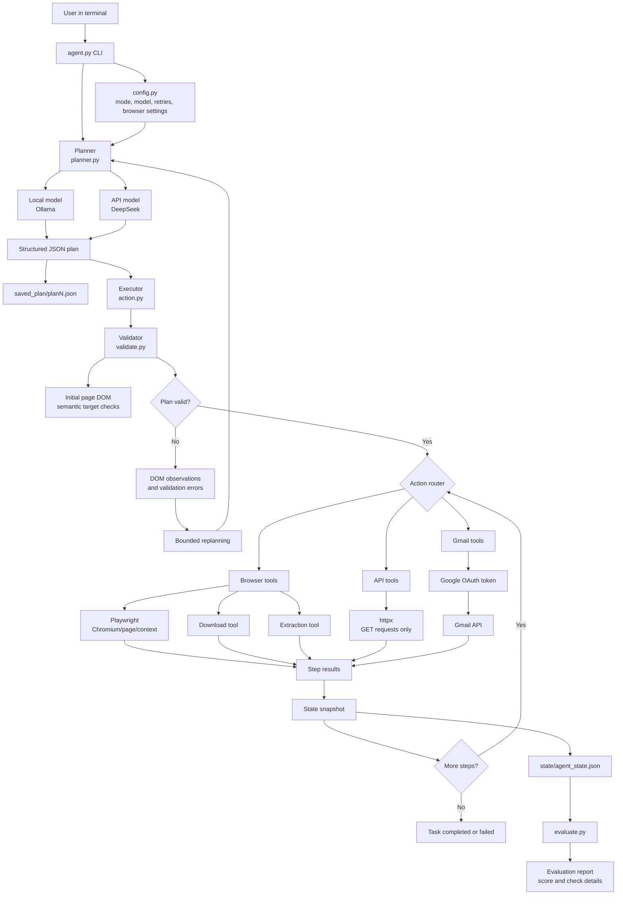
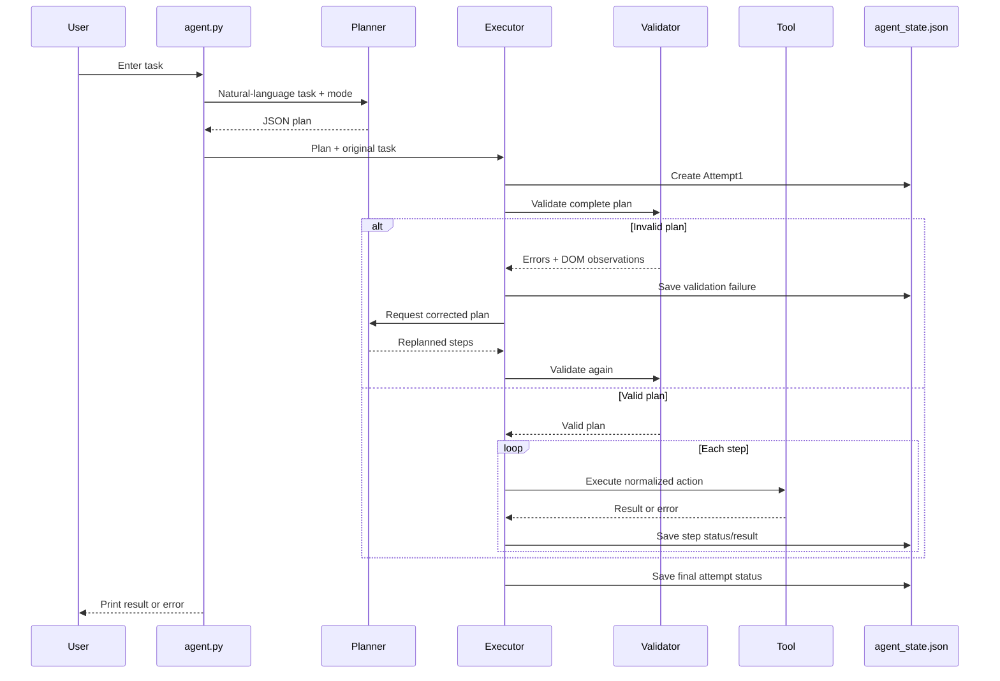
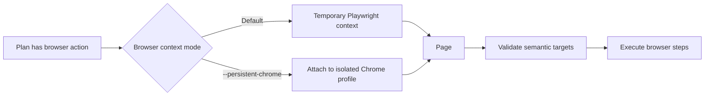
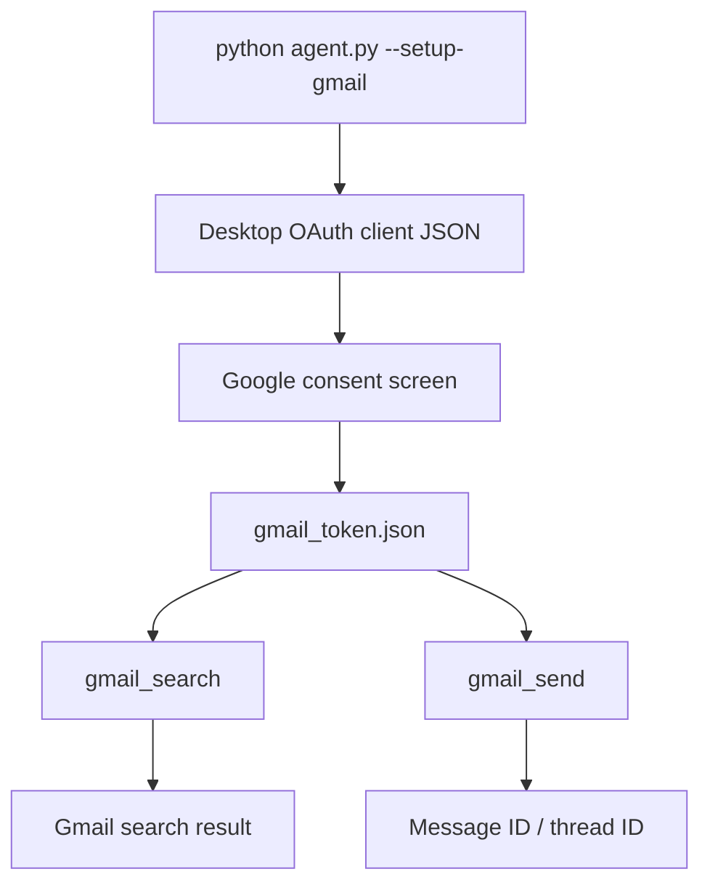
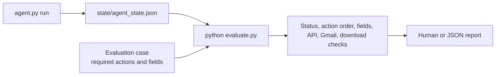

# Browser Automation Agent Architecture

## 1. Scope

This project is a command-line agent. It accepts a natural-language task,
creates a structured plan, validates the plan, executes the plan through the
appropriate tool, and records the complete run.

The project does not provide a browser UI. It can use a browser internally for
web tasks, but the user interacts with it through `agent.py` in the terminal.

## 2. Complete system architecture



## 3. Main execution lifecycle



The replan loop is bounded by `MAX_REPLAN_ATTEMPTS`. A failure is recorded
before it is raised to the CLI, so the latest state remains inspectable.

## 4. Component responsibilities

| Component | Responsibility |
| --- | --- |
| `agent.py` | CLI entry point, argument parsing, model-mode selection, setup commands, and top-level orchestration |
| `config.py` | Model names, API mode, browser mode, paths, timeout, and retry settings |
| `Planner/planner.py` | Converts the user request into JSON actions, calls Ollama or DeepSeek, saves plans, and creates replans |
| `Validator/validate.py` | Checks action structure, URLs, references, semantic targets, controls, and wait values |
| `Executor/action.py` | Runs validation, chooses the action path, executes steps, handles state, and manages replanning |
| `tools/api_client.py` | Executes safe generic HTTP `GET` requests and returns normalized API results |
| `tools/download.py` | Downloads direct file responses and saves them under `downloads/` |
| `tools/extractor.py` | Extracts requested fields, direct resource links, product data, and blocked-page information |
| `tools/dom_observation.py` | Captures useful page details after target or extraction failures |
| `integrations/gmail.py` | Authorizes Gmail and performs search/send operations using OAuth |
| `state/agent_state.py` | Atomically writes the latest state snapshot |
| `evaluation/evaluator.py` | Checks a saved run against a selected test case |
| `evaluate.py` | CLI entry point for the non-destructive evaluator |

## 5. Planner action contract

The planner produces a top-level object with a `steps` list:

```json
{
  "steps": [
    {
      "action": "navigate",
      "url": "https://example.com"
    },
    {
      "action": "extract",
      "category": "article",
      "fields": ["article_title", "first_paragraph"]
    }
  ]
}
```

Supported action types:

| Action | Execution path | Side effect |
| --- | --- | --- |
| `navigate` | Playwright page | Page navigation |
| `fill` | Playwright semantic locator | Changes form input |
| `press` | Playwright keyboard action | Submits or changes page state |
| `click` | Playwright semantic locator | Page interaction |
| `select` | Playwright select control | Changes form selection |
| `wait` | Playwright wait | Delays execution |
| `extract` | In-page JavaScript | Read-only page inspection |
| `download` | Direct page request | Writes a file to `downloads/` |
| `api_request` | `httpx` | Read-only HTTP `GET` |
| `gmail_search` | Gmail API | Reads Gmail data |
| `gmail_send` | Gmail API | Sends an email |

The planner should use semantic roles and accessible names for browser
controls. It should not invent CSS selectors or element IDs.

## 6. Tool routing and execution

The executor currently uses action names as the tool interface. Conceptually,
the routing is:

```text
plan step
   |
   +-- api_request  ------> tools/api_client.py ------> httpx GET
   +-- gmail_search ------> integrations/gmail.py ---> Gmail API
   +-- gmail_send   ------> integrations/gmail.py ---> Gmail API
   +-- download     ------> tools/download.py -------> Playwright request
   +-- extract      ------> tools/extractor.py ------> page.evaluate()
   +-- browser step ------> Executor + Validator ----> Playwright locator
```

API-only plans containing only `api_request`, `gmail_search`, or `gmail_send`
do not require Chromium. Plans containing browser actions use Playwright.

### Current tool abstraction status

The project has separate tool modules and a shared action contract, but the
final dispatch is still implemented as action branches inside
`Executor/action.py`. A future tool registry could provide each tool with:

- a name and description;
- argument validation;
- browser/API/authentication requirements;
- side-effect and retry metadata;
- one execution function;
- one normalized result format.

That would make it easier to add new CLI integrations without expanding the
executor's conditional block.

## 7. Browser execution modes



The persistent profile is stored in `.browser_profile/` and is separate from
the user's normal Chrome profile. Credentials should be entered manually in
the browser, never in the task prompt or terminal command.

## 8. API-first execution

For a clearly identified read-only endpoint, the planner can create:

```json
{
  "action": "api_request",
  "method": "GET",
  "url": "https://api.example.com/items",
  "params": {"query": "python"},
  "headers": {}
}
```

The validator requires an absolute HTTP/HTTPS URL, method `GET`, and object
values for `params` and `headers`. The API client returns:

```json
{
  "status_code": 200,
  "content_type": "application/json",
  "data": {},
  "url": "https://api.example.com/items"
}
```

Generic API writes are intentionally unsupported. Gmail sending is a separate
OAuth tool because it requires a specific Gmail permission and has an external
side effect.

## 9. Gmail flow



The sender is the authenticated Gmail account. The generated plan contains
the recipient, subject, and body for a send operation, but never contains the
OAuth access or refresh token. Gmail sends are not automatically retried after
an uncertain network failure because Gmail may already have accepted the
message.

## 10. Extraction and download flow

```mermaid
flowchart TD
    PAGE[Current page] --> EXTRACT[extract step]
    EXTRACT --> FIELDS[Structured fields]
    FIELDS --> REF[{from: stepN.data.field}]
    REF --> NAV[navigate or download]
    NAV --> FILE[downloads/filename]
    PAGE --> BLOCKED{Human verification?}
    BLOCKED -->|Yes| REPORT[Report blocked; do not bypass]
```

The extractor can return article fields, page titles, official/documentation
URLs, product listings, and direct downloadable resources. Resource detection
supports common image, document, data, archive, audio, video, font, and
installer extensions, as well as links with a `download` attribute.

A download must point to a direct file response. An HTML landing page is
rejected instead of being saved as a successful download.

## 11. State and artifacts

```text
saved_plan/
    planN.json                 Initial generated plan
    replan/replanN.json        Corrected plans

state/agent_state.json         Latest task snapshot
downloads/                     Downloaded files
traces/                        Screenshots and run traces
.browser_profile/              Optional isolated authenticated Chrome profile
gmail_token.json               Local Gmail OAuth token
```

The state file contains the task, numbered attempts, plans, validation
results, execution step statuses, results, errors, and replan information.
Only the latest run is kept in the default state path. Copy it to another
filename before starting a new run if it must be evaluated later.

## 12. Evaluation architecture



Evaluation is post-run and non-destructive. It does not call the planner,
open Chromium, download files, or send Gmail. It reads the latest attempt from
the state snapshot and compares it with a selected case:

```bash
python evaluate.py --list
python evaluate.py --case 7
python evaluate.py --case 7 --json
python evaluate.py --state state/older-run.json --case 7
```

Exit codes:

- `0`: all evaluation checks passed;
- `1`: at least one evaluation check failed.

## 13. Security boundaries

- The CLI task is the user-facing boundary.
- Generic API requests are restricted to `GET`.
- Gmail uses OAuth instead of an API key.
- Gmail credentials, token files, `.env`, and browser profiles stay local and
  private.
- Gmail send requires an explicit `gmail_send` action.
- Human-verification challenges are reported, not bypassed.
- Downloaded content is written only to the configured downloads directory.
- Replanning is bounded to avoid infinite model/tool loops.

## 14. Current limitations

- Generic API mutations are not implemented.
- Gmail delete, modify, drafts, attachments, and push notifications are not
  implemented.
- The evaluator checks saved state; it does not independently verify an email
  reached a recipient or that a downloaded file has the expected contents.
- Browser targets depend on the current page's accessible names and DOM.
- Some websites may block automation or require human verification.
- A new task replaces the default `state/agent_state.json` snapshot.
